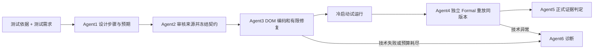

# WebAgent v0.6

用六个逻辑 Agent 完成自然语言驱动的 Web GUI 功能测试。当前开发入口是
`run_demo.py --target dynamic`：真实模型规划、实时 DOM 编码与有限调试、完整冷启动、
独立 Chrome 正式重放和基于证据的判定。Selenium 保持为唯一浏览器自动化工具。

`app_ui.py` 是 Dynamic 单页面操作台，复用同一个六 Agent Pipeline。
v0.3 的 Fixture/固定 arXiv 模板入口仍供旧 CLI 和回归测试使用。

## 可视化操作台

在下文配置好 ChromeDriver、Chrome 后启动：

```powershell
.\.venv\Scripts\python.exe -m streamlit run app_ui.py --server.address 127.0.0.1
```

打开终端显示的本地地址（默认 `http://127.0.0.1:8501`）。选择 DeepSeek、OpenAI、
OpenRouter 或硅基流动，填写可编辑的模型 ID 和本次 API Key，再填写目标 URL、
可选测试依据和测试需求，确认授权后点击“开始测试”。高级设置可修改 API Base URL、
JSON 输出模式，也可单独发送一次小型请求测试连接。连接成功不等于完整 Pipeline 验收成功。
模型 ID/接口地址可从 `.env` 同名公开字段读取；Key 不预填、不回退后台 Key，不写入任务、
证据、日志或生成代码。只在控制侧内存调用模型，启动后清除页面密码框；查看历史无需 Key。
`.env.example` 包含四个服务商的 CLI 配置示例。A/B/C 原始输入仍保留在开发材料和回归测试，
正常操作界面不再提供 Demo 下拉框。

界面每秒更新真实事件、六 Agent/冷启动/Formal 状态、当前步骤、耗时、模型调用和失败修复次数。
结果包含 Oracle 来源与正式实际值、正式截图、冻结源码和可下载报告。Agent6 只在需要时调用，
不会为了展示进度强制运行。事件计数是适配器调用次数，不包含 SDK 内部网络重试。

启动后输入配置折叠为只读，首屏展示六张阶段卡片、中文活动和模型本次等待时长。
Agent4 与正式执行合并展示；异常诊断仅在实际调用时显示。
结果页优先展示失败 Oracle，或关键成功证据：并列对照来源条款、冻结预期和 Formal 实际值。
每次只展示选定 Oracle/步骤的一张正式截图；未执行的依赖步骤单列，不计作已验证失败。
代码、报告、JSON 和原始事件可在次级展开区查看与下载。

前端固定 **Agent3 逐步调试及完整冷启动无头，Agent4 Formal 有头**；需在有桌面的 Windows
会话中启动服务才能看到正式浏览器。Trial/Formal 独立 Profile、冻结源码和 Oracle 规则不变。
没有 Headless 开关。下文 CLI 的默认全部无头和 `--show-browser` 行为保持兼容。
“正式执行页面停留时间”可设 0～3 秒，默认 1.5 秒。控制侧在每步正式取证后（包括最后一步）
保持浏览器打开再继续；不向生成代码插入 sleep，不改变源码哈希或操作/取证阶段超时。
停留仍受会话总期限约束。时间敏感的网站请设置为 0。后台编写调试及完整模拟运行无延时。

任务在后台线程执行，刷新可通过地址栏 `?job=<id>` 回到同一任务。单个 Streamlit 服务一次
只接受一个活动任务；重复点击复用同一 ID。结束后点击“新建测试任务”才能再次启动。
`artifacts/ui_jobs/` 保存任务事件及状态；服务重启只恢复记录并标记中断，不自动重跑或调用 API。
左侧“最近任务”可只读查看最近 20 项保存记录；切换历史不调用模型或启动被测浏览器。
执行中可查看历史并返回活动任务，此时不能新开任务。
当前没有取消按钮、跨服务器任务调度或远程多用户权限控制；请仅绑定本机访问。

## 本地运行

项目使用本地 Windows Python、Selenium、Chrome 和 ChromeDriver，不依赖 Docker。
安装项目依赖后，使用项目虚拟环境运行：

```powershell
python -m venv .venv
.\.venv\Scripts\python.exe -m pip install -r requirements.txt
.\.venv\Scripts\python.exe -m pytest -q
```

在当前 PowerShell 配置已安装且与 Chrome 匹配的 Driver；路径是示例，需按本机修改：

```powershell
$env:CHROMEDRIVER_PATH = 'C:\path\to\chromedriver.exe'
$env:CHROME_BINARY = 'C:\Program Files\Google\Chrome\Application\chrome.exe'
Test-Path $env:CHROMEDRIVER_PATH
```

Dynamic 的受控 Runtime 不自动下载 Driver，环境变量只对当前终端及其子进程有效。
CLI 模型凭据通过控制侧环境变量或项目 `.env` 配置，例如 `DEEPSEEK_API_KEY`；
不写入源码、生成的 Selenium 脚本或日志。复用 `llm_adapter.py`，也支持已有
OpenRouter/OpenAI/SiliconFlow provider 选项；前端独立使用用户输入。验收记录注明实际使用的 provider/model。

下面的依据是人工构造的演示规格，不是 Selenium 官方说明。访问需获得授权；
页面表单只填写测试数据，不输入密码或真实个人信息。

```powershell
$basis = '在 Web form 页面填写 Text input 并点击 Submit 后，结果页面应显示 Received!。'
$requirement = '在 Text input 输入 WebAgent Test，点击 Submit，验证提交后的页面反馈符合测试依据。'
.\.venv\Scripts\python.exe run_demo.py --target dynamic --mode llm --provider deepseek --url 'https://www.selenium.dev/selenium/web/web-form.html' --allow-live-site --allow-local-research --test-basis $basis --requirement $requirement
```

默认无头 Chrome；添加 `--show-browser` 才显示窗口。`--test-basis` 是可选的纯文本测试依据，
`--requirement` 是本次测试需求。两者独立保存，不解析 Word/PDF。只根据需求测试时，
结论不代表说明书符合性。`--only-generate` 只规划、审核契约，仍调用模型，不启动浏览器。

## 六 Agent 与数据流



Pipeline 管阶段、权限、预算和终止；Agent 不自行调用其他 Agent。默认失败步骤最多
3 次尝试、任务最多 5 次失败修复，保持已有时间预算。正确操作后的业务值不匹配不应
触发“修到符合预期”。必要目标缺失可由 Agent2 审核候选阻塞，再冷启动并由 Agent4
独立确认；依赖步骤标记为 `NOT_EXECUTED`，不能用 Trial 证据直接判 FAIL。

| 结果 | 含义 |
| --- | --- |
| PASS | 必要正式证据符合冻结预期 |
| FAIL | 可靠正式证据证明不符合冻结预期 |
| ERROR | 代码、浏览器或 Runtime 等技术异常 |
| INCONCLUSIVE | 输入/预期不明确或证据不足，不能可靠判定 |

CLI 对 PASS 或仅规划正常返回 0；FAIL、ERROR、INCONCLUSIVE 的完整运行返回 1。
非零退出码本身不能证明 Selenium 执行异常，应读取 `final_verdict.json`。

## 模块职责

| 模块 | 用途 |
| --- | --- |
| `web_agent/agents/` | 六角色，保留 Dynamic 方法和仍使用的旧模板方法 |
| `pipeline.py`、`schema.py` | 单一编排入口；步骤、Oracle 来源、类型、依赖及交付契约 |
| `selenium_runtime.py`、`local_worker.py` | 会话管理、独立 Profile/运行目录、分阶段超时、进程树清理；Worker 独占 WebDriver |
| `checked_selenium.py`、`rendered_text.js` | 受限 Selenium 解释与统一取证，完整正文读取、去重、必要目标清点 |
| `dom_inspector.py` | 观察已有 driver，批量 DOM 提取、压缩和脱敏；不创建浏览器 |
| `llm_adapter.py` | 控制侧模型配置和 API 调用 |
| `ui_tasks.py`、`app_ui.py` | 后台任务防重/刷新恢复、只读进度快照与单页操作台；执行仍委托原 Pipeline |
| `fixture_server.py` | 本地合成页面与可独立重置的服务端数据，供回归与基础设施验收 |
| `evidence_plan.py`、`probe_plan.py`、`probe.py`、`probe_runner.py` | 旧模板的检查点取证和受限详情补证；非 Dynamic 业务路径 |
| `report.py` | 旧模板 HTML 报告；Dynamic 当前保存 JSON 与 `report.md` |

Agent3 的正式导入位置是 `web_agent.agents.generator`。已移除仅重导出的
`web_agent.generator`；旧的 `Agent2.approve()` 使用 `build_contract()` 替代。
一次性页面检查在 `selenium_runtime.inspect_page()`；实时观察仍为
`dom_inspector.observe_session(driver)`。

每次产物在独立 `artifacts/<run_id>/`。Dynamic 的主要文件：

- `test_inputs.json`、`input_review.json`、`test_contract.json`：原始输入、审核、Oracle 引文与位置。
- `agent3_debug.json`、`generated_test.py`、`agent3_delivery.json`：开发记录、冻结源码/哈希和冷启动交付。
- `agent3_cold_trial_*.json`、`formal_evidence.json`、`trial/`、`formal/`：独立执行及 DOM/截图/测量引用。
- `final_verdict.json`、`cleanup.json`、`llm_calls.json`、`report.md`：结论、清理、调用元数据及运行说明。

## 保留的旧入口

以下仍为固定搜索模板，用于离线/浏览器回归，不是自由 Dynamic 编码：

```powershell
.\.venv\Scripts\python.exe run_demo.py --target fixture --mode template
.\.venv\Scripts\python.exe run_demo.py --target fixture-bug --mode template
.\.venv\Scripts\python.exe run_demo.py --target fixture --mode template --demo-evidence-gap
.\.venv\Scripts\python.exe run_demo.py --target fixture --mode template --demo-broken-locator
.\.venv\Scripts\python.exe run_infrastructure_check.py --driver-path $env:CHROMEDRIVER_PATH
.\.venv\Scripts\python.exe -m streamlit run app_ui.py
```

`--target arxiv` 也是旧固定入口；任意任务应使用 Dynamic 并指定授权 URL。
不因旧测试名包含 v0.2/v0.3 就删除仍有效的异常处理、取证和契约回归。

## 边界与验收

本地子进程与受限解释器都不是操作系统沙箱，没有文件/网络/CPU/内存权限隔离。
Worker 不继承模型凭据；禁止任意 Python、Shell、反射和系统文件读取。
页面内容是不可信数据。复杂窗口选择、iframe/Shadow DOM 完整遍历、自定义控件的
全面负面证明尚不支持；证据不足保持 INCONCLUSIVE，技术故障仍为 ERROR。
浏览器 Profile 重置不等于远端服务端数据重置，有副作用操作需授权及可重放环境。

v0.5 架构清理的基线、模块依赖前后对比、删除理由、pytest 与三项真实模型/Chrome
回归记录见 `docs/v05_architecture_cleanup_acceptance.md` 和
`artifacts/v05_architecture_cleanup/`。Mock 测试不替代真实端到端验收。
`AGENTS.md`、`docs/` 和运行产物当前被 `.gitignore` 忽略，不会自动同步到其他克隆；
README 和源码中的说明可随仓库共享。

v0.6 前端及分阶段浏览器模式的验收见 `docs/v06_frontend_acceptance.md` 与
`artifacts/v06_ui_acceptance/`；未通过的真实运行不会以离线测试替代。
本轮演示布局、历史查看和证据选择优化见 `docs/v06_presentation_acceptance.md` 与
`artifacts/v06_presentation_acceptance/`，真实验收严格限于 A/B 各一次。
