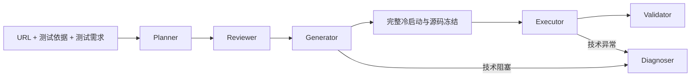

# WebAgent：多智能体 Web GUI 自动化测试框架

用户提供目标 URL、测试依据和测试需求，WebAgent 通过六个逻辑 Agent 规划、审核、生成并执行 Selenium 测试，再依据冻结预期与独立正式证据给出结论。测试目标是验证网页行为是否符合规格，产物包括可检查的 Python 代码、契约、截图、DOM 观察和判定解释。

主要入口是 Streamlit 操作台 [app_ui.py](app_ui.py)，也可使用 [run_demo.py](run_demo.py) 的 Dynamic CLI。两者复用同一条 Pipeline。

## 核心能力

- 理解自然语言需求，将测试依据与本次操作目标分别保存。
- 追踪 Oracle（预期结果）的原文来源，审核步骤、依赖和证据要求后冻结契约。
- 根据当前 DOM 动态生成 Selenium Python，逐步试运行并有限修复技术问题。
- 完整冷启动重跑后冻结源码，以哈希校验交付独立 Chrome 正式执行。
- 采集与步骤、Oracle 关联的正式 DOM、截图、实际值、异常和清理记录。
- 支持日期语义比较，以及格式不明时的可信日历选中态关联取证。
- 输出 PASS、FAIL、ERROR、INCONCLUSIVE，区分业务不符合、技术故障和证据不足。
- 在 Web 操作台查看实时进度、模型调用、正式证据、冻结代码和报告。

当前输入为纯文本，未接入 Word/PDF 文档解析。

## 六智能体架构

六个角色是同一 Python 项目中的模块，不是六个独立模型进程，也并非每个角色都调用 LLM。

| 角色 | 职责 |
| --- | --- |
| Planner / Agent1 | 从原始输入设计步骤和有来源的预期，不编写页面定位器 |
| Reviewer / Agent2 | 审核测试语义、冻结契约，并审核执行实现 |
| Generator / Agent3 | 观察页面，动态编写、试跑和有限修复 Selenium 代码，完成冷启动 |
| Executor / Agent4 | 在独立会话重放同一冻结源码，采集正式证据 |
| Validator / Agent5 | 根据冻结 Oracle 确定性核验正式证据，给出四态结果 |
| Diagnoser / Agent6 | 在技术故障或预算耗尽时按需诊断，给出停止和排查建议 |



Pipeline 负责阶段、权限、预算和终止。默认每步最多 3 次尝试、每任务最多 5 次技术修复；业务 FAIL 不应触发“修改到符合预期”的重试。必要控件缺失需独立正式确认，依赖操作标记未执行。

## 核心技术机制

**规格与契约冻结。** 测试依据描述参考规格，测试需求描述本次目标；Oracle 保留来源条款及位置。代码定位方式可以修订，指定操作和预期不能由 Generator 随意改变。未提供测试依据时，结论只针对需求本身。

**动态生成与受限执行。** 模型代码以受限 Python/Selenium 子集解释执行，限制语法、操作、同源访问、时间和修复次数。页面内容作为不可信数据，模型不能使用任意 Shell、文件读取或 JavaScript 执行。该机制不等于操作系统安全沙箱。

**调试与正式运行隔离。** 逐步调试成功后必须从初始状态完整重跑，再交 Agent4 使用相同源码和契约哈希独立执行。Trial 和 Formal 使用不同浏览器会话与 Profile；开发截图不能替代正式证据。

**可信证据核验。** Agent5 比较冻结预期和正式测量值，保留原值、证据引用及解释。普通 `equals` 严格比较类型和值，不把近似反馈当作相等。

**日期语义。** `date_equals` 将有明确来源的中文或 ISO 日期规范化，不擅自规定页面显示格式。字段有明确格式时优先使用；格式未知时，可由同次正式采集的唯一关联日历、年月标题和真实选中格消除歧义。支持有限的 ARIA 关联网格及经实例身份和日期状态交叉验证的 datepicker 结构。仅截图、`today`/`active` 类名、多候选或冲突不足以判 PASS。必要的弹窗重开操作须写入冻结代码并完成冷启动。

| 结果 | 含义 |
| --- | --- |
| PASS | 必要正式证据满足冻结预期 |
| FAIL | 可靠正式证据证明不符合冻结预期 |
| ERROR | 模型服务、代码、浏览器或执行环境等技术问题导致测试不能正常完成 |
| INCONCLUSIVE | 输入、预期或必要证据不足，无法可靠判定 |

## 环境与安装

主要验证环境为 Windows、Python 3.12、Chrome 和与其版本匹配的 ChromeDriver。项目不需要 Docker。依赖见 [requirements.txt](requirements.txt)；以下命令在项目根目录的 PowerShell 执行：

```powershell
python -m venv .venv
.\.venv\Scripts\python.exe -m pip install -r requirements.txt
```

预先安装 Chrome 与 ChromeDriver，填写本机实际路径：

```powershell
$env:CHROMEDRIVER_PATH = 'C:\tools\chromedriver.exe'
$env:CHROME_BINARY = 'C:\Program Files\Google\Chrome\Application\chrome.exe'
Test-Path $env:CHROMEDRIVER_PATH
Test-Path $env:CHROME_BINARY
```

两项检查应返回 `True`。Dynamic Runtime 要求预先提供 Driver，不自动下载；环境变量对当前终端和子进程生效。展示正式 Chrome 时需有可交互的桌面会话。

## Web 操作台

```powershell
.\.venv\Scripts\python.exe -m streamlit run app_ui.py --server.address 127.0.0.1
```

打开终端显示的本机地址，通常为 `http://127.0.0.1:8501`：

1. 选择 AI 服务商，填写可编辑的模型 ID 和本次 API Key。
2. 输入授权测试的目标 URL、可选测试依据和测试需求。
3. 设置正式页面停留时间（0～3 秒，默认 1.5 秒）。
4. 确认站点测试与独立重跑授权，使用可安全重复的测试数据，然后开始。
5. 查看阶段进度、冷启动、独立 Formal、Oracle 对比、正式截图及最终结果。

支持 DeepSeek、OpenAI、OpenRouter、硅基流动的配置入口；**真实账户完整验收范围为 DeepSeek**，其余三家目前只有离线配置和路由验证。模型 ID、接口和 JSON 支持以实际账户为准。高级设置提供 Base URL、JSON 模式及手动连接测试；连接测试也会调用模型，不代表完整链路验收成功。

前端要求使用者自行输入 Key，不预填或回退后台 Key；启动后清除密码框，Key 不作为任务或证据字段落盘。公开模型设置可从本地 `.env` 读取。CLI 的环境配置独立于此规则。

操作台固定后台调试和冷启动无头，Formal 使用独立可见 Chrome。停留发生在每步正式取证之后，不插入生成代码；时间敏感页面可设为 0。单个服务一次接受一个活动任务，支持刷新恢复和只读历史查看；服务重启不会自动重跑。请绑定本机使用，当前没有远程多用户权限管理或任务取消界面。

## 可视化演示模式（Windows）

将 VS Code 的终端摆在左侧，在该终端按原方式启动 Streamlit：

```powershell
.\.venv\Scripts\python.exe -m streamlit run app_ui.py --server.address 127.0.0.1
```

自行将 Streamlit 前端摆在右侧。默认仍是**常规模式**；在新任务配置中选择“演示模式”后开始，详细日志实时显示在启动 Streamlit 的同一个终端中，无需另开终端。模式和窗口区域在任务启动时冻结，历史任务只读。

演示模式展示真实 Agent3 Trial 浏览器；Cold 保持无头，Formal 使用新的独立 Session/Profile，并覆盖同一右半屏。测试浏览器关闭后露出原 Streamlit。终端复用执行事件，显示结构化规划、审核反馈、生成完成的真实代码片段、浏览器动作和正式判定；没有模拟逐字输出。启动器会公开展示本次任务内容，请使用不含隐私的演示数据。

模式选择不会移动 VS Code、创建终端或启动第二个 Streamlit 服务。模型调用仍需在 UI 中输入本次 Key 并授权。

窗口按所选显示器工作区分半，考虑任务栏及 DPI。窗口最小尺寸、远程桌面和混合 DPI 多显示器可能导致警告；半屏会真实触发网页响应式布局。演示模式不保证 Pipeline 在 60 秒内完成，可在录制后剪辑加速；不会跳过审核、冷启动或正式取证。

## CLI 使用

查看当前参数：

```powershell
.\.venv\Scripts\python.exe run_demo.py --help
```

CLI 从控制侧环境变量或本地 `.env` 读取模型配置，字段示例见 [.env.example](.env.example)。按所选服务商配置，例如在当前 PowerShell 中输入临时 DeepSeek Key：

```powershell
$temporaryKey = Read-Host 'DeepSeek API Key' -AsSecureString
$env:DEEPSEEK_API_KEY = [System.Net.NetworkCredential]::new('', $temporaryKey).Password
```

以下提交反馈示例需使用者确认可以低频、重复执行。测试依据是人工构造的规格，不是网站官方承诺：

```powershell
$basis = '在 Web form 页面填写 Text input 并点击 Submit 后，结果页面应显示 Received!。'
$requirement = '在 Text input 输入 WebAgent Test，点击 Submit，验证提交后的页面反馈符合测试依据。'
.\.venv\Scripts\python.exe run_demo.py --target dynamic --mode llm --provider deepseek --model deepseek-flash --url 'https://www.selenium.dev/selenium/web/web-form.html' --allow-live-site --allow-local-research --test-basis $basis --requirement $requirement
Remove-Item Env:DEEPSEEK_API_KEY
Remove-Variable temporaryKey
```

默认全部无头，`--show-browser` 显示执行浏览器；这与前端固定的后台/正式分阶段模式不同。`--only-generate` 仅进行规划和审核，仍调用模型，不启动被测浏览器。`--allow-local-research` 是对本地受限执行的显式授权，不表示开启了系统沙箱。

完整运行的 PASS 返回退出码 0，FAIL / ERROR / INCONCLUSIVE 返回 1；入口异常返回 2。仅规划正常返回 0。应结合最终判定文件解释退出码。

`fixture`、`fixture-bug`、`arxiv` 仍保留为固定模板兼容入口及回归用途；自然语言动态任务应显式选择 `--target dynamic --mode llm`。

## 测试与已验收范围

默认回归不调用真实模型，真实 Chrome 用例需要显式启用：

```powershell
.\.venv\Scripts\python.exe -m pytest -q

# 配置好 Chrome / Driver 后，运行本地日期浏览器用例
$env:WEBAGENT_RUN_BROWSER_TESTS = '1'
.\.venv\Scripts\python.exe -m pytest -q tests/test_date_browser_live.py tests/test_calendar_browser_live.py tests/test_date_navigation_browser_live.py
Remove-Item Env:WEBAGENT_RUN_BROWSER_TESTS
```

2026-11-10 完整离线回归结果为 **467 passed、29 skipped**。跳过项不能算作浏览器验证；本地日期导航三个 Chrome 场景已另行启用实测，覆盖双向跨年和按钮无变化时的技术失败。其脚本由人工编写，只证明导航策略、浏览器交互和独立取证；跨年生成及审核提示词增强尚未用真实模型复验。

已保存的真实 DeepSeek + Chrome 验收包括：

| 场景 | 冻结规格与正式观察 | 结果 |
| --- | --- | --- |
| 正常提交反馈（Demo A） | 预期 Received!，正式观察 Received! | PASS |
| 错误反馈规格（Demo B） | 人为指定 Accepted!，正式观察 Received! | FAIL |
| 必要控件缺失（Demo C） | 人为要求可见 Reset，正式证据确认不存在 | FAIL |
| 日期语义与关联取证 | 输入值 11/10/2026，由关联正式日历确认 2026-11-10 | PASS |

Demo A/B 也经过真实 Streamlit 操作台验收。B/C 验证的是对错误规格的识别，**不代表 Selenium 官方网站有 Bug**。日期正式 PASS 运行 ID 为 `dynamic_20261110_085230_f186a7`；更早缺少关联证据的运行保持 INCONCLUSIVE，没有事后改判。

这些结果限于已执行场景，不构成跨网站稳定性保证。本地私有验收记录未随仓库发布，README 不将其作为可下载材料链接。回归源码位于 [tests/](tests/)，覆盖来源、类型、冻结一致性、独立证据、故障恢复、凭据隔离及日期边界。

## 目录与运行产物

```text
app_ui.py                 Streamlit 操作台
run_demo.py               CLI 入口
web_agent/agents/         六角色实现
web_agent/pipeline.py     编排与预算
web_agent/schema.py       契约与来源校验
web_agent/selenium_runtime.py / local_worker.py
                          浏览器会话、超时和清理
web_agent/checked_selenium.py
                          受限解释与统一取证
web_agent/dom_inspector.py
                          当前 DOM 观察
web_agent/date_semantics.py / calendar_state.js
                          日期语义及关联快照
web_agent/llm_adapter.py   控制侧模型适配
tests/                    离线和可选本地浏览器回归
artifacts/                本地运行产物，默认忽略
```

每次 Dynamic 测试写入独立运行目录，包含原始输入、冻结契约、生成源码与交付哈希、冷启动记录、Formal 证据、最终判定、模型调用元数据和清理记录。`.env`、缓存、运行产物及本地开发报告默认被 [.gitignore](.gitignore) 排除；分享运行材料前仍需检查个人路径、页面数据和日志。

## 能力边界

- 已有有限的同源新窗口跟随与回归覆盖；复杂多窗口选择、iframe、Shadow DOM 和非标准控件未充分验证。
- 日期控件只支持当前明确实现的关联结构；相对日期、缺少年份、时区时间、多选及浏览器原生弹窗等不能保证自动处理。
- LLM 可能产生不稳定或不可执行的代码；有限调试与审核不能保证任意程序正确。
- 本地子进程、Profile 隔离和受限解释器不提供操作系统级文件、网络或资源安全隔离。
- 浏览器重置不等于远端数据重置。购买、删除、账号修改等有副作用操作需要明确授权和可重置的测试环境。
- 当前面向本地单任务使用；不宣称可在任意网站稳定执行，也未完成全部模型服务商的真实账户验收。
