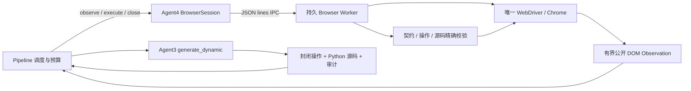

# WebAgent v0.4 第二阶段开发报告

日期：2026-11-04。范围：Agent3 动态 Selenium 源码生成、Agent4 持续浏览器会话、Pipeline 动态执行循环。

验收材料：[测试与执行摘要](C:/Users/35254/Desktop/WebAgent/artifacts/v04_stage2_final_verification_20261104/verification_summary.json)、[搜索任务完整源码](C:/Users/35254/Desktop/WebAgent/artifacts/v04_stage2_final_verification_20261104/search/all_step_sources.py)、[表单任务完整源码](C:/Users/35254/Desktop/WebAgent/artifacts/v04_stage2_final_verification_20261104/form/all_step_sources.py)、[JUnit 测试结果](C:/Users/35254/Desktop/WebAgent/artifacts/v04_stage2_final_verification_20261104/pytest.xml)。

## 1. 交付结论与开发基线

已在原有六 Agent 工程中增加动态执行路径：冻结语义契约 → 同一会话观察 DOM → Agent3 生成封闭操作及 Python 源码 → Agent4 校验并执行 → 重新观察 → 下一步。

两个结构不同的本地业务流程均经真实无头 Chrome 执行完成；另外验证了跨域重定向、跨域图片和子 Worker 的阻断。最终完整 pytest：**144 passed，0 failed，0 skipped，45.38 秒**。其中 139 项为离线测试，5 项为显式启用的真实 Chrome 测试。默认不启动 Chrome 的测试命令实测为 **139 passed，5 skipped，5.56 秒**。

动态步骤完成的状态是 `execution_status=COMPLETE`，整个测试的功能裁决仍为 **`INCONCLUSIVE`**。本阶段没有实现 Agent5 动态 Oracle 裁决，也没有调用 Agent6 自动恢复。

- 开发开始与交付时 Git HEAD 均为 `fe4a76dc8f41dc532aecc7734799c8e5fc74b04f`。
- 已阅读本地被 Git 忽略的 `AGENTS.md`，以及 Agent3/4、旧 Runtime、DOM Inspector、Pipeline、第一阶段协议与测试。
- 开发开始时 pytest 实测为 **94 passed**。工作区已有第一阶段未提交的协议、Agent1/2、Pipeline 和测试修改；本阶段保留这些修改。
- 没有执行 Git 提交或推送，没有进入第三阶段；原有第一阶段报告和历史验证结果保留。
- `docs/` 和 `artifacts/` 被 Git 忽略；此报告和证据在本地，不能据此假设远程仓库已经包含它们。

## 2. 持续浏览器会话架构



**Agent4 的 Worker 独占 WebDriver**。Agent3 仅收到公开 DOM 元数据、冻结契约、当前步骤、必要的前序输出与执行策略；它没有浏览器对象。Pipeline 持有会话传输接口，统一调度步骤。

选择持久子进程，是为了同时保留浏览器状态和建立可终止的执行边界：初始化一次 Chrome，所有步骤与 DOM 观察均在该 Chrome 内完成；IPC 只传 JSON，不序列化或跨进程传递 WebDriver/WebElement。真实 WebElement 引用仅保存在 Worker 内，观察中的 `node_id` 只是当前快照的句柄。

正常结束发送 `close`，Worker 调用 `driver.quit()` 并关闭 CDP 连接。执行失败后 Worker 不再接受后续操作并清理会话。父进程处理 RPC 失败、异常退出与硬超时：Windows 使用仅针对该 Worker PID 的 `taskkill /T /F`，其他平台使用独立进程组清理。正常关闭也有等待上限，超限后转为进程树终止。这里的子进程用于生命周期管理与隔离，并非操作系统级 Python 沙箱。

默认预算及边界：

| 控制项 | 默认值 | 生效位置 |
| --- | --- | --- |
| 最大步骤数 | 40 | Pipeline 预检、Worker 二次检查 |
| 最大观察次数 | 85 | Pipeline 与 Worker，包含最终页面观察 |
| 单步预算 | 8 秒 | 一次观察、生成及执行共享截止时间 |
| 总预算 | 120 秒 | Pipeline 与会话传输；包含启动和生成时间 |
| 启动上限 | 25 秒 | Worker 启动 RPC，同时受总预算约束 |
| DOM 元素上限 | 100 | 每次公开观察，上限可配置至 150 |

一次失败立即停止，未开始的步骤标记 `SKIPPED`。没有自动重启浏览器、重新解释需求或修改已审核 Oracle。模型调用超过预算时关闭浏览器；调用线程只能接触协议数据，迟到的结果不会被执行。供应商调用线程本身不能被 Python 强制中断，迟到时仍可能完成生成文件写入，这是当前明确保留的限制。

## 3. Agent3/4 接口与动态生成机制

### Agent3

```python
Agent3SeleniumGenerator.generate_dynamic(
    contract, step_id, observation, run_dir,
    state=previous_outputs, policy=ExecutionPolicy(),
    mode="llm", llm=injectable_json_model,
) -> dict
```

返回 `step_id`、`operation`、实际 `source`、`source_file` 和 `audit`。每步保存 `dynamic_S_*.py` 与 `generation_S_*.json`。

模型输出仅允许以下结构：

```json
{
  "step_id": "S_city",
  "observation_id": "当前观察 ID",
  "target_id": "当前观察中的 node_id",
  "wait": "enabled",
  "reads": {},
  "expected_change": "none",
  "rationale": "根据可访问名称、控件类型和关系选择该元素"
}
```

动作类型、数据和步骤语义来自冻结契约；模型选择当前节点、等待条件、输出读取器和页面变化条件。输入引用由可信代码解析，不能由模型增加任意值。跨步骤引用只读取已声明且已完成的输出；Agent3 提示中只携带本步引用所需的前序值。

可信生成器组合通用 Selenium 原语：`navigate / fill / select / check / click / submit / observe / wait`。根据契约动作、实时控件、读取要求以及本次 DOM/导航变化条件，生成不同的 Python 语句，而非套用一个搜索业务脚本。没有新增搜索网站、商品、报名业务的 Selenium 专用流程函数。

`template` 动态定位仅支持唯一的精确可访问名称/文本匹配和明确序号；有歧义就拒绝。`llm` 使用原有可注入 `JSONModel.complete_json()`，未另建模型框架。旧 `generate()` 保持原有流程。

### Agent4

```python
session = Agent4TestExecutor().open_dynamic(
    contract, run_dir, policy=ExecutionPolicy(), headless=True,
)
observation = session.observe(timeout=remaining_step_budget)
outcome = session.execute(artifact, timeout=remaining_step_budget)
session.close()
```

公开观察包含页面 URL（去查询和片段）、标题、观察 ID、截断标识，以及节点的标签、类型、文本、可访问名称、role、可见/可用状态、父节点和表单关系、有限 select 选项。节点引用不离开 Worker。原有会创建并关闭浏览器的 `inspect_page()` 不用于动态路径。

执行结果包含 `step_id/status/outputs/evidence`、契约与源码摘要、对应 `observation_id`、`session_id`、公开 URL、Selenium 能力调用轨迹和耗时。协议异常、执行失败、预算耗尽均返回结构化错误并终止；错误记录关联当前步骤。当前证据是文本、值、布尔、URL 或直接子元素计数，没有动态截图或完整 DOM 归档。

## 4. Pipeline 接口与执行循环

```python
result = run_pipeline(
    engine="dynamic", mode="llm", execute_dynamic=True,
    requirement=user_requirement, target_url=target_url,
    llm=model, output_root=output_root,
)
```

第一阶段的 `engine="dynamic"` 默认仍只规划；显式开启 `execute_dynamic=True` 才进入执行。`engine="legacy"` 与 `mode="template/llm"` 维度继续独立。动态模式不转入 arXiv 模板，不接收旧补证/恢复演示选项；执行开关与 `only_generate` 冲突时拒绝。

已审核契约也可直接调用：

```python
run_dynamic_contract(contract, run_dir, mode="llm", llm=model, policy=policy)
```

执行顺序由契约的依赖拓扑确定。每步先观察并落盘，再调用 Agent3；执行前复查契约完整性及磁盘源码，随后由同一 Agent4 会话校验并执行。成功后更新步骤状态、已声明输出和 Evidence ID 映射。每次动作使上次观察失效，下一步必须重新观察。全部步骤后再做一次最终页面观察，关闭会话并保存结果。

当前实现采用逐语义步骤生成；明确 URL 的导航不调用模型，没有要求每个内部 Selenium 调用都调用模型。本阶段未增加多步骤批量优化。

## 5. 安全校验

1. **封闭操作语言**：拒绝额外字段、Python、CSS/XPath、自定义 URL、动态 API 名称、任意表达式和额外动作。操作必须绑定契约中的步骤与当前观察 ID。检查依赖、重复执行、输入引用、控件类型、可用状态及证据读取器；等价节点组存在多个候选时检查已审核序号。
2. **可信源码渲染与二次校验**：Agent3 保存源码与 SHA-256。Pipeline 检查保存文件未被修改；Worker 独立重新解析冻结契约、验证操作并重新渲染，只有与可信源码逐字一致时才编译执行。不是仅做 AST 检查。任意模型 Python 即使语法合法也被拒绝。
3. **固定执行能力**：代码只能由渲染器产生固定的 Selenium 能力调用，执行上下文移除 builtins，不提供导入、反射、文件或进程操作。空 builtins 只是附加防护；真正的代码边界是封闭操作和源码精确匹配。没有声称可安全执行任意 Python。
4. **域名和导航控制**：限定审核目标的精确 HTTP(S) origin（含端口），默认仅本机回环地址。非本机目标需要显式 live 许可。点击前检查链接、表单 action、下载和目标上下文；页面脚本产生的 HTTP(S) 请求、重定向与资源加载通过 CDP Fetch 在发出前拦截。拦截初始化失败或断开即停止，不降级为无保护执行。
5. **附加浏览器限制**：禁止下载，拒绝新页面、子 Worker 等额外上下文；对子 target 启用暂停控制。配置 `ws/wss/ftp` 阻断，不支持这类业务。该策略不等于针对恶意站点所有 Chrome/网络协议的操作系统级网络沙箱；WebRTC、浏览器漏洞和复杂协议的对抗未验证。
6. **观察与敏感数据限制**：不发送完整 HTML、Cookie、storage 或表单输入值给 Agent3。过滤 password/hidden/file、敏感属性及 `data-private/data-sensitive` 子树，连父节点文本中的私有后代也剔除。邮箱和长数字做有限遮罩；执行前再次核查控件类型及敏感状态，避免观察后变成文件/密码输入框。公开页面文本仍可能有个人信息，有限规则不代表通用 PII 检测。契约声明的输出值会作为必要证据保留。
7. **DOM 是不可信数据**：Agent3 提示明确声明，网页文字不能改变系统指令。即使页面诱导模型返回 Python、额外动作或越界目标，结构和 Worker 校验也不会因模型输出而放开。

## 6. 两个实际执行任务与证据

测试使用本机动态 Fixture 和真实无头 Chrome，模型定位部分使用 Mock LLM；没有调用真实供应商 API。契约复用第一阶段的搜索及表单场景，先适配本地 URL 和实际控件的语义名称，再由 Agent2 模板审核冻结，执行期间没有修改契约。

生产生成器和执行器没有本地页面名称或路径分支；这些页面业务只存在于 Fixture，场景和 Mock 定位策略只存在于测试中。Mock 根据当前 DOM 的可访问名称和序号选择节点。

| 项目 | 搜索流程 | 多字段表单流程 |
| --- | --- | --- |
| 需求 | 搜索“机器人”，选择第二项，读取该项和详情标题 | 姓名“张三”、城市“杭州”，进入预览，再返回读取保留姓名 |
| 步骤 | 导航 → 填写 → 提交 → 读取第二项 → 点击第二项 → 读详情 | 导航 → 填写 → select → 点击提交 → 读预览 → 返回 → 读输入值 |
| 实际执行步骤 | 6 | 7 |
| DOM 观察次数 | 7 | 8 |
| 页面变化 | 搜索提交和详情导航改变 URL | 点击提交后异步替换同 URL 的 DOM；返回发生导航 |
| 读取结果 | `E_result=机器人乙`、`E_detail=机器人乙` | `E_preview=张三`、`E_retained=张三`；DOM 另显示预览城市“杭州” |
| 会话证据 | 全部步骤同一 session_id，详情显示 sessionStorage 状态“同一会话” | 全部步骤同一 session_id，返回后输入值仍在 |
| 最终结果 | `COMPLETE / INCONCLUSIVE` | `COMPLETE / INCONCLUSIVE` |

测试对输出作了断言，但这些断言是开发验收测试，不是运行中的 Agent5 动态 Oracle 实现。

归档根目录：`artifacts/v04_stage2_final_verification_20261104/`。`search/`、`form/` 保存各任务完整契约、逐步源码、生成审计、观察和执行证据；`security_redirect/`、`security_image/`、`security_worker/` 保存负向结果。三个安全测试均在首个导航步骤停止，返回网络策略错误并关闭会话；pytest 同时断言第二个本机服务的越界请求计数为 0。

每步对应链为：`test_contract.json` 的契约摘要 → `observation_NNN.json` → `generation_S_*.json` 的定位依据/读取器/等待和源码摘要 → `dynamic_S_*.py` → `dynamic_steps.json` 的相同源码摘要、观察 ID、实际 API 轨迹及会话 ID。归档时再次逐步验证源码 SHA-256 与审计和执行结果一致，汇总保存在 `verification_summary.json`。

`search/all_step_sources.py` 与 `form/all_step_sources.py` 是实际片段的顺序汇编，供人工阅读。它们需要逐步 Agent4 上下文，不能把整份拼接文件当作独立脚本直接执行。报告附录包含这些真实片段的完整内容。

## 7. 修改与新增文件

以下为**本阶段**修改，第一阶段既有未提交修改不重复列作本次新增。

| 类型 | 文件 | 实现功能 |
| --- | --- | --- |
| 修改 | `web_agent/agents/generator.py` | 增加 `generate_dynamic`；实时节点绑定、操作校验、通用原语渲染、源码与定位审计 |
| 修改 | `web_agent/agents/executor.py` | 增加 `open_dynamic`；由 Agent4 创建持久会话传输接口 |
| 修改 | `web_agent/dom_inspector.py` | 增加 `observe_session` 和静态 JS；同会话结构化观察、关系摘要和敏感节点过滤 |
| 修改 | `web_agent/pipeline.py` | 显式动态执行入口、逐步循环、共享单步截止时间、总预算、失败终止、执行与阶段报告 |
| 新增 | `web_agent/dynamic_execution.py` | 有界策略、origin 授权、封闭操作协议、输入解析和可信 Python 渲染 |
| 新增 | `web_agent/browser_session.py` | 持久子进程 JSON IPC、环境变量白名单、RPC 截止时间、进程树清理 |
| 新增 | `web_agent/browser_worker.py` | 独占 WebDriver、二次校验、固定 Selenium 能力、步骤结果与证据采集 |
| 新增 | `web_agent/browser_network.py` | CDP Fetch 发出前拦截与额外 target 控制；失败时停止 |
| 新增 | `web_agent/dynamic_fixture.py` | 两种本地业务 HTML/JS，以及安全负向页面；没有 Selenium 业务脚本 |
| 新增 | `tests/test_v04_execution.py` | 45 项离线用例和 5 项显式启用的真实 Chrome 用例 |
| 新增 | 本报告 | 架构、接口、源码、验证结果和能力边界 |
| 产物 | `artifacts/v04_stage2_final_verification_20261104/` | pytest 日志/JUnit、协议、生成代码、逐步观察与实际执行轨迹 |

第一阶段的 `dynamic_schema.py`、`test_v04_planning.py` 及 designer/reviewer/schema 既有修改继续保留；本阶段未改写 Agent1/2 的审核逻辑或语义协议。

## 8. 测试与复现

环境：Windows，Python 3.12.3，Selenium 4.36.0，Chrome 156.0.8078.74，缓存 ChromeDriver 156.0.8078.80。

默认离线命令（不要求 Key，不启动浏览器）：

```powershell
python -B -m pytest -q -p no:cacheprovider
```

结果：**139 passed，5 skipped，5.56 秒**。相比开始时 94 项离线基线，新增 45 项离线用例，原有测试无非预期退化。

最终完整命令（浏览器可执行路径需按机器环境设置；basetemp 应选择新的输出目录）：

```powershell
$env:WEBAGENT_REAL_CHROME='1'
$env:CHROMEDRIVER_PATH='C:\Users\35254\.cache\selenium\chromedriver\win64\156.0.8078.80\chromedriver.exe'
python -B -m pytest -q -p no:cacheprovider --basetemp artifacts/v04_stage2_final_verification_20261104/pytest --junitxml artifacts/v04_stage2_final_verification_20261104/pytest.xml
```

本次执行结果：**144 passed in 45.38s**，无跳过项。实际命令通过 `Tee-Object` 另保存 `pytest.log`。请勿为了复现而覆盖已有验收目录；pytest 会清理其 basetemp。

新增测试覆盖：不同动作的真实源码、非法模型操作/Python 拒绝、输入不可篡改、origin 和 live 许可、严格预算、Worker 二次源码校验、网络拦截初始化失败、过期观察与依赖/重复步骤、第一项冒充第二项、生成超时后不执行迟到结果、步骤/观察/总预算耗尽、磁盘源码篡改、传输超时触发进程树清理、控件敏感类型变化、Pipeline 显式执行入口、跨步骤数据引用，以及上述五项真实 Chrome 验收。

另对 37 个源码/测试/入口 Python 文件执行 AST 语法检查，通过；`git diff --check` 通过。传输超时的进程树终止分支使用模拟进程测试，未把它描述为真实 Chrome 挂死恢复验收。

## 9. 兼容性、未验证项与后续接口

- 保留 `web_agent.generator` 旧导入路径和原有 `generate()`。
- 保留 `selenium_runtime.execute_test()`，没有修改旧 Runtime 的浏览器生命周期；动态路径使用单独的持久 Worker。
- 保留 v0.3 模板/LLM、Fixture、补证和恢复分支；本次完整测试包含原有离线回归。本次没有重新执行旧版真实 Chrome 演示、真实 arXiv、真实 LLM 或 Streamlit 交互验收。
- 不改四类功能裁决语义。阶段二新增的是执行完成状态，不是整体功能 PASS。
- 当前支持有限的通用原生控件操作、标量读取、单 origin、单窗口、无敏感登录凭证的工作流。iframe、Shadow DOM、富文本/拖拽、文件上传下载、跨域认证、额外窗口/Worker 和复杂控件没有通用支持；网站不满足这些约束时应拒绝或终止，不增加网站专用模板掩盖限制。
- 真实 LLM 的跨网站定位质量、提示注入对真实模型的语义影响，以及任意线上网站上的可用性均未验证。安全校验独立于模型，但不能据此宣称已验证任意网站自主测试。

供第三阶段后续使用、但本阶段未实施的接口：冻结 `DynamicTestContract.design.oracles/evidence_requirements`、`design_digest`、执行结果的 `evidence[evidence_id]`（含 step_id/output/kind/value）、`step_states`、逐步源码/观察摘要及 session_id。动态 Agent5 可以消费这些数据判断 Oracle；任何补证或恢复仍应由 Pipeline 调度，继续校验冻结契约与预算，不能改写测试语义。

## 附录：两项任务实际执行的完整 Python 片段

以下内容从本次真实 Chrome 验收保存的逐步源码汇编逐字复制。原始逐步文件与 SHA-256 绑定关系见各任务 `generation_S_*.json` 和 `dynamic_execution.json`。

源码摘要基于 UTF-8、统一为 LF 换行的文本内容；它用于核对实际编译的源码。Windows 磁盘文件的 CRLF 原始字节摘要可能不同，核对应先按文本读取并统一换行。

### search

```python
# Review bundle of actual per-step sources; execute each step ONLY through Agent4.
# This concatenation is not a standalone Selenium script.

# ---- S_open ----
# WebAgent v0.4 step S_open; contract 2784df56c96807abab469516e96f1563fd795ae74bc64e9615b769b15dd44de1
outputs = {}
api.navigate(inputs.get('url', target_url))
api.ready()

# ---- S_query ----
# WebAgent v0.4 step S_query; contract 2784df56c96807abab469516e96f1563fd795ae74bc64e9615b769b15dd44de1
outputs = {}
element = api.wait('n_3', 'enabled')
element.clear()
element.send_keys(inputs['value'])

# ---- S_search ----
# WebAgent v0.4 step S_search; contract 2784df56c96807abab469516e96f1563fd795ae74bc64e9615b769b15dd44de1
outputs = {}
element = api.wait('n_4', 'enabled')
before = api.page_token()
api.guard_target(element)
element.click()
api.transition(before, 'navigation')

# ---- S_result ----
# WebAgent v0.4 step S_result; contract 2784df56c96807abab469516e96f1563fd795ae74bc64e9615b769b15dd44de1
outputs = {}
element = api.wait('n_5', 'visible')
outputs['title'] = api.read_text(element)

# ---- S_detail ----
# WebAgent v0.4 step S_detail; contract 2784df56c96807abab469516e96f1563fd795ae74bc64e9615b769b15dd44de1
outputs = {}
element = api.wait('n_6', 'enabled')
before = api.page_token()
api.guard_target(element)
element.click()
api.transition(before, 'navigation')

# ---- S_title ----
# WebAgent v0.4 step S_title; contract 2784df56c96807abab469516e96f1563fd795ae74bc64e9615b769b15dd44de1
outputs = {}
element = api.wait('n_0', 'visible')
outputs['title'] = api.read_text(element)
```

### form

```python
# Review bundle of actual per-step sources; execute each step ONLY through Agent4.
# This concatenation is not a standalone Selenium script.

# ---- S_open ----
# WebAgent v0.4 step S_open; contract 03a6939a33e933592650e265527df99764091f88d822a5422fa698f343e58f00
outputs = {}
api.navigate(inputs.get('url', target_url))
api.ready()

# ---- S_name ----
# WebAgent v0.4 step S_name; contract 03a6939a33e933592650e265527df99764091f88d822a5422fa698f343e58f00
outputs = {}
element = api.wait('n_3', 'enabled')
element.clear()
element.send_keys(inputs['value'])

# ---- S_city ----
# WebAgent v0.4 step S_city; contract 03a6939a33e933592650e265527df99764091f88d822a5422fa698f343e58f00
outputs = {}
element = api.wait('n_5', 'enabled')
api.select_by_visible_text(element, inputs['value'])

# ---- S_next ----
# WebAgent v0.4 step S_next; contract 03a6939a33e933592650e265527df99764091f88d822a5422fa698f343e58f00
outputs = {}
element = api.wait('n_8', 'enabled')
before = api.page_token()
api.guard_target(element)
element.click()
api.transition(before, 'dom')

# ---- S_preview ----
# WebAgent v0.4 step S_preview; contract 03a6939a33e933592650e265527df99764091f88d822a5422fa698f343e58f00
outputs = {}
element = api.wait('n_1', 'visible')
outputs['name'] = api.read_value(element)

# ---- S_back ----
# WebAgent v0.4 step S_back; contract 03a6939a33e933592650e265527df99764091f88d822a5422fa698f343e58f00
outputs = {}
element = api.wait('n_4', 'enabled')
before = api.page_token()
api.guard_target(element)
element.click()
api.transition(before, 'navigation')

# ---- S_retained ----
# WebAgent v0.4 step S_retained; contract 03a6939a33e933592650e265527df99764091f88d822a5422fa698f343e58f00
outputs = {}
element = api.wait('n_3', 'visible')
outputs['name'] = api.read_value(element)
```
